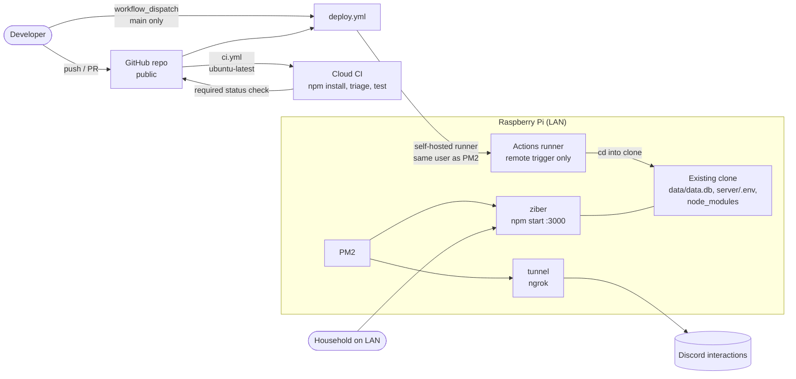
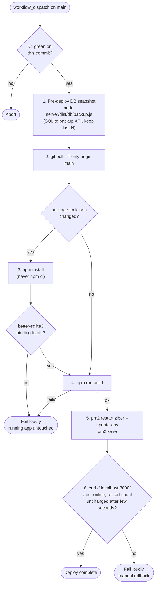
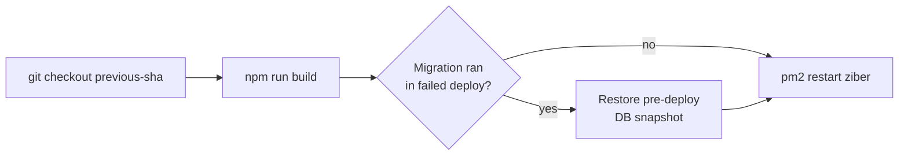

# Deployment

Planned CI/CD flow for the Raspberry Pi, based on the "CI/CD for Raspberry Pi deploys" item in [backlog.md](../backlog.md). Not implemented yet; today every step after the push is manual over SSH.

## Topology

## Deploy workflow

## Manual rollback (no auto-rollback in v1)

## Guardrails

- `ci.yml` never uses `self-hosted`; only `deploy.yml` does, and only via `workflow_dispatch` (public repo, fork PRs must not reach the Pi).
- Restart with `pm2 restart`, never `pm2 start` from another path (wrong `cwd` silently creates an empty DB).
- Avoid deploying around 08:00 (in-process reminder cron has no catch-up); restart drops in-memory participant pickers and undo tokens.
- The `tunnel` process is unaffected by deploys.
- Manual SSH deploy remains available as a fallback.
